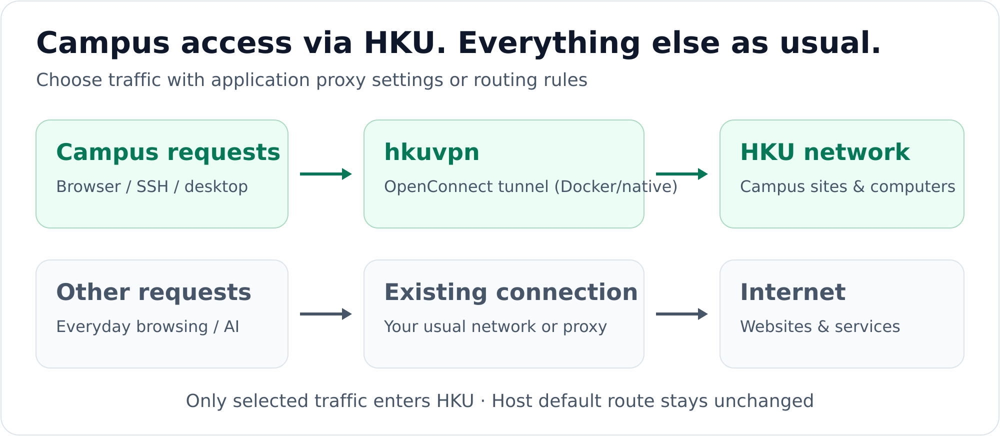
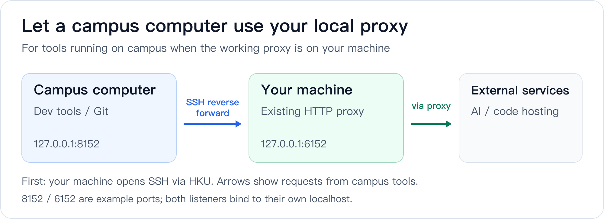

#  hkuvpn

[](LICENSE)
[](https://awesomemygo.dev/apps/hku-vpn)

**Access HKU's campus network while keeping your usual Internet connection.**

[English](README.md) · [简体中文](README.zh-CN.md) · [Project website](https://jialiangZ.github.io/hkuvpn/) · [Full guide](docs/guide.en.md)

Need campus resources, lab SSH, or remote desktop while your browser and AI tools keep using their usual connection? hkuvpn runs the HKU VPN inside Docker — or natively on Windows, without WSL — and exposes a local proxy. You choose which requests enter the campus network; your host's default route stays unchanged.

## What can you use it for?

| Your goal | How |
|---|---|
| Access HKU websites and campus resources | Set an application proxy or route by domain |
| SSH or remote desktop into a campus computer | Send that host's connections through HKU |
| Give campus development tools access to your local proxy | Share your existing proxy over reverse SSH (advanced) |



OpenConnect establishes the VPN inside the container, and local SOCKS5 / HTTP ports provide access to it. **Set a proxy directly in an application, or add Clash or Surge for automatic routing by domain or IP.**

## On Windows? There is an app.

The whole thing comes as a desktop app (`HKUVPN.exe`, MyGo native UI — no
WSL, no Docker, no console window). Download
**`HKUVPN-windows-<version>.zip`** from the
[releases](https://github.com/jialiangZ/hkuvpn/releases), unpack it, run
`bin\get-tools.ps1` once as administrator (it installs OpenConnect and
downloads gost), and start `HKUVPN.exe`. Type your account and Portal PIN
in the window, press Connect, and type the six-digit code when it asks.

[`START-HERE.md`](windows/mygo-app/START-HERE.md) ·
[`START-HERE.zh-CN.md`](windows/mygo-app/START-HERE.zh-CN.md) ·
[the app's README](windows/mygo-app/README.md)

Prefer a shell? Run `shell\bootstrap.ps1` once for the account and Portal
PIN, then `shell\install-path.ps1` once (user PATH, no administrator
rights), and a bare `hkuvpn` connects from any terminal: the MFA code is
typed there, closing the window after "Connected" keeps the tunnel, and a
window closed or interrupted with Ctrl+C before that cannot leave a worker
waiting for a code.
`hkuvpn --status`, `--stop`, `--logs` are the same launcher flags
everywhere else.

The Docker edition below is the other way in, and it still works the same
way.

## Quick Start

You need a working **Docker** runtime, `openssl`, a VPN-enabled HKU account, your **static Portal PIN**, and a **Microsoft Authenticator code**. The launcher uses `vpn2fa.hku.hk` with MFA; reachability depends on your network.

<details>
<summary>Need a Docker runtime?</summary>

On macOS, you can use Colima with Homebrew installed:

```bash
brew install colima docker
colima start --cpu 2 --memory 2 --disk 20 --vm-type vz --mount-type virtiofs
```

Docker Desktop also works. Use Docker Engine on Linux. On Windows, enable Docker Desktop's WSL2 integration and run the commands below inside WSL2.

</details>

### 1. Build the image

Check that `docker info` works, then run:

```bash
git clone https://github.com/jialiangZ/hkuvpn.git ~/hkuvpn
cd ~/hkuvpn
docker build -t local/vpn docker/
```

> **Upgrading from v1.0.x?** The Docker edition moved into `docker/` in
> v1.1.0. After `git pull`, update these four places:
>
> | Was | Now |
> |---|---|
> | `docker build -t local/vpn .` | `docker build -t local/vpn docker/` |
> | `~/hkuvpn/bin/hkuvpn` | `~/hkuvpn/docker/bin/hkuvpn` |
> | `~/hkuvpn/examples/hku.env.example` | `~/hkuvpn/docker/examples/hku.env.example` |
> | `source ~/hkuvpn/examples/hkuvpn.zsh` | `source ~/hkuvpn/examples/shells/hkuvpn.zsh` |
>
> Your `~/.vpn/` credentials are untouched, and the launcher still finds the
> old layout if you keep an older checkout.

### 2. Set your account and PIN

```bash
mkdir -p ~/.vpn
cp ~/hkuvpn/docker/examples/hku.env.example ~/.vpn/hku.env
nano ~/.vpn/hku.env
```

Set `HKU_USER` to your HKU account, for example `youruid@connect.hku.hk`. Then create the PIN file:

```bash
(umask 077; touch ~/.vpn/hku.pass)
chmod 600 ~/.vpn/hku.pass
nano ~/.vpn/hku.pass
```

Enter only your **static Portal PIN**, not the changing Authenticator code. In Nano, save with `Ctrl+O`, `Enter`, then exit with `Ctrl+X`. Your account and PIN stay outside the repository in `~/.vpn/`.

### 3. Connect and verify

```bash
~/hkuvpn/docker/bin/hkuvpn
```

Run `hkuvpn`; when the `MFA code` prompt appears, enter the current six-digit Authenticator code and wait for `Connected` — the proxy is then ready. A mistyped or expired code simply re-prompts. The classic foreground mode is `hkuvpn -f` (keep the terminal open; `Ctrl+C` disconnects).

Test from a **second terminal**:

```bash
curl -x socks5h://127.0.0.1:1080 -I https://www.hku.hk/
```

HTTP response headers confirm that the proxy request works; access to individual campus resources still depends on your account permissions. If this fails, see [Troubleshooting](docs/guide.en.md#troubleshooting).

## Use the connection

| Integration | Address or configuration |
|---|---|
| SOCKS5 in an application | `127.0.0.1:1080` |
| HTTP proxy in an application | `127.0.0.1:1088` |
| Automatic routing with Clash Verge Rev / Mihomo | [Example](examples/clients/clash-verge.yaml) · [Setup](docs/guide.en.md#clash-verge-rev--mihomo) |
| Automatic routing with Surge | [Example](examples/clients/surge.conf) · [Setup](docs/guide.en.md#surge) |
| SSH / remote desktop | [Connect to a campus computer](docs/guide.en.md#ssh-and-remote-desktop) |
| Windows / WSL | [PowerShell wrapper](examples/shells/hkuvpn.ps1) · [SSH example](examples/clients/ssh_config.wsl.example) · [Setup](docs/guide.en.md#windows--wsl) |
| Windows native, no WSL | [Native port](windows/README.md) · [Desktop app](windows/mygo-app/README.md) · [Validation checklist](windows/VALIDATION.md) |

The proxies listen on localhost and forward TCP traffic; `socks5h` also resolves DNS through the proxy. With a rules client, **the VPN servers themselves must use a direct connection or an existing proxy**, to avoid routing back into hkuvpn. The examples include these rules.

Everyday commands:

```bash
~/hkuvpn/docker/bin/hkuvpn              # smart connect: prompts for MFA, waits for the tunnel
~/hkuvpn/docker/bin/hkuvpn              # run again while connected: reports status
~/hkuvpn/docker/bin/hkuvpn --check      # pre-flight check (exit 0 = ready)
~/hkuvpn/docker/bin/hkuvpn -f           # classic foreground connect
~/hkuvpn/docker/bin/hkuvpn -d           # background connect (waits for MFA readiness)
~/hkuvpn/docker/bin/hkuvpn --mfa <code> # deliver the code to the detached container
~/hkuvpn/docker/bin/hkuvpn --status     # layered health check (scriptable exit codes)
~/hkuvpn/docker/bin/hkuvpn --logs       # follow the container logs
~/hkuvpn/docker/bin/hkuvpn --stop       # stop
~/hkuvpn/docker/bin/hkuvpn --recover    # repair the Docker backend without MFA
```

[Install the short `hkuvpn` command](docs/guide.en.md#install-the-short-hkuvpn-command) · [Change the default ports](docs/guide.en.md#use-a-proxy-directly)

## Advanced: share your local proxy with a campus computer

Your development tools run on a campus computer, but the proxy they need is on your own machine. A reverse SSH tunnel lets those remote processes reach external services through your existing local proxy.



Keep the HKU VPN, SSH tunnel, and existing local proxy running. This step is unnecessary for AI websites used in your local browser. [Configuration and verification →](docs/guide.en.md#reverse-ssh-for-a-campus-computer)

## Repository layout

Two editions live side by side, each self-contained:

| Edition | Directory | Use it on |
|---|---|---|
| Docker | [`docker/`](docker/) | Linux, macOS, Windows via WSL2 |
| Native Windows | [`windows/`](windows/) | Windows 10/11, without WSL or Docker |

```text
hkuvpn/
├── README.md                  # English README (this file)
├── README.zh-CN.md            # 简体中文说明
├── LICENSE                    # MIT License
├── NOTICE                     # Upstream attribution + third-party notices
├── index.html                 # Project website (GitHub Pages)
├── docker/                    # Docker edition: Linux / macOS / Windows-WSL
│   ├── Dockerfile             # Image: OpenConnect + gost + MFA entrypoint
│   ├── bin/hkuvpn             # Launcher: connect, --status, --stop, …
│   ├── etc/vpnc-script        # Routing script executed inside the container
│   ├── examples/              # hku.env template for this edition
│   ├── hku-connect.exp        # Expect script that answers the MFA form
│   └── keys/                  # OpenConnect release key (build-time check)
├── windows/                   # Native Windows edition: no WSL, no Docker
│   ├── bin/hkuvpn.ps1         # Launcher: connect, --status, --stop, …
│   ├── bin/get-tools.ps1      # Fetches and verifies gost + OpenConnect
│   ├── etc/vpnc-script-win.js # Split-tunnel-only routing script
│   ├── examples/              # hku.env template for this edition
│   ├── mygo-app/              # Desktop app (HKUVPN.exe): MyGo native UI
│   ├── tests/                 # session-flow.ps1: the session lifecycle regression
│   ├── README.md              # Edition guide (English / 简体中文)
│   └── VALIDATION.md          # Field validation checklist (English / 简体中文)
├── examples/                  # Shared integration examples
│   ├── clients/               # Clash Verge Rev, Surge, SSH configuration
│   └── shells/                # Zsh / Bash / Fish / PowerShell wrappers
└── docs/                      # Long-form guides and diagrams
```

---

## Getting help

Something not working? [Open an issue](https://github.com/jialiangZ/hkuvpn/issues)
— the form asks for the pre-flight output and the log lines, which is what
makes a bug fixable. The app's log is at `%LOCALAPPDATA%\HKUVPN\app.log`
and the session log at `%TEMP%\hkuvpn\openconnect.log`.

Want to help? The app is a Go program (`windows/mygo-app`), the worker is
PowerShell (`windows/bin/hkuvpn.ps1`), and the session lifecycle has a
regression script (`windows/tests/session-flow.ps1`). Pull requests are
welcome; `go vet` and `go test` in `windows/mygo-app` are the checks that
run on every push.

---

More: [Troubleshooting](docs/guide.en.md#troubleshooting) · [Security](docs/guide.en.md#security) · [Compatibility and versions](docs/guide.en.md#compatibility-and-versions)

Adapted from [ethack/docker-vpn](https://github.com/ethack/docker-vpn) via the HKU edition by [rqhu1995/docker-vpn](https://github.com/rqhu1995/docker-vpn). Released under the [MIT License](LICENSE); upstream attribution and third-party notices are in [NOTICE](NOTICE). See [Credits and licensing](docs/guide.en.md#credits-and-licensing).
