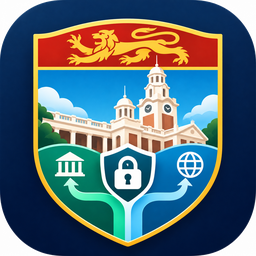
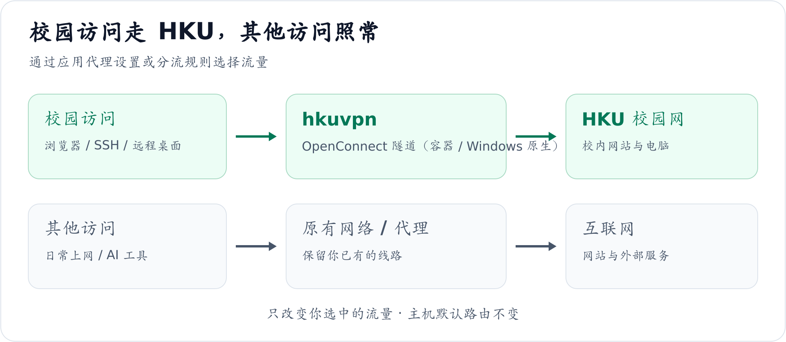
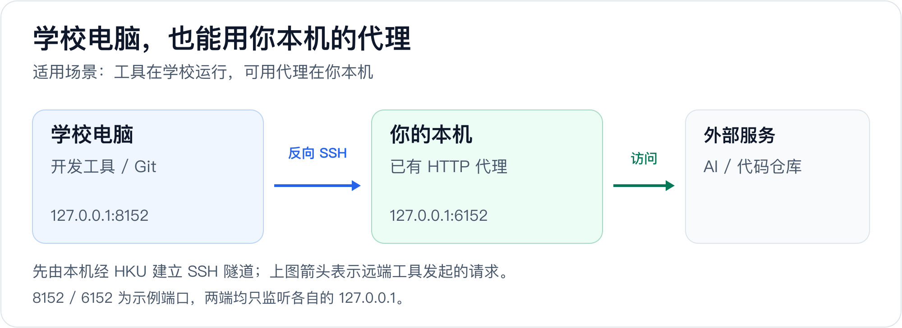

#  hkuvpn

[](LICENSE)

**访问港大校园网，同时继续使用你原来的上网线路。**

[English](README.md) · [简体中文](README.zh-CN.md) · [项目网站](https://jialiangZ.github.io/hkuvpn/) · [详细指南](docs/guide.zh-CN.md)

查校内资源、SSH 到实验室、远程控制学校电脑时，还想让浏览器和 AI 工具继续走原来的网络？hkuvpn 把 HKU VPN 放进 Docker（Windows 也可免 WSL 原生运行），提供本地代理，由你选择哪些请求进入校园网，主机默认路由保持不变。

## 能帮你做什么

| 你的需求 | 用法 |
|---|---|
| 访问 HKU 网站和校内资源 | 给应用设置代理，或按域名分流 |
| SSH / 远程桌面连接学校电脑 | 让目标主机的连接走 HKU |
| 学校电脑上的开发工具需要本机代理 | 通过反向 SSH 借用本机已有代理（进阶） |



容器内由 OpenConnect 建立 VPN，本机通过 SOCKS5 / HTTP 端口使用隧道。**应用可以直接设置代理；按网站或 IP 自动分流时，再接入 Clash 或 Surge。**

## 用 Windows？有现成的 App

整套东西有桌面版（`HKUVPN.exe`，MyGo 原生界面 —— 不用 WSL、不用 Docker、
不弹终端窗口）。从 [Releases](https://github.com/jialiangZ/hkuvpn/releases)
下载 **`HKUVPN-windows-<版本号>.zip`**，解压后以管理员身份运行一次
`bin\get-tools.ps1`（它会安装 OpenConnect 并下载 gost），然后启动
`HKUVPN.exe`：在窗口里填账号和 Portal PIN，点 Connect，它要码时输入
6 位数字即可。

[`START-HERE.md`](windows/mygo-app/START-HERE.md) ·
[`START-HERE.zh-CN.md`](windows/mygo-app/START-HERE.zh-CN.md) ·
[App 的说明](windows/mygo-app/README.zh-CN.md)

更喜欢命令行？跑一次 `shell\install-path.ps1`（写用户 PATH，不需要管理员权限），
之后任何终端里裸 `hkuvpn` 就能连：动态码就输在当前窗口，连上后关窗不影响隧道；
连上之前关窗也不会留下一个傻等验证码的 worker。`hkuvpn --status`、`--stop`、
`--logs` 与其它平台用的是同一套启动器参数。

下面的 Docker 版是另一条路，用法没有变。

## 快速上手

准备好可用的 **Docker**、`openssl`、已开通 VPN 的 HKU 账号、**Portal 静态 PIN** 和 **Microsoft Authenticator 验证码**。当前入口为 `vpn2fa.hku.hk`，仍需 MFA；实际连通性取决于所在网络。

<details>
<summary>还没有 Docker？</summary>

macOS 可使用 Colima（需先安装 Homebrew）：

```bash
brew install colima docker
colima start --cpu 2 --memory 2 --disk 20 --vm-type vz --mount-type virtiofs
```

也可使用 Docker Desktop；Linux 使用 Docker Engine；Windows 在 Docker Desktop 启用 WSL2 集成后，从 WSL2 运行以下命令。

</details>

### 1. 构建镜像

确认 `docker info` 正常，再执行：

```bash
git clone https://github.com/jialiangZ/hkuvpn.git ~/hkuvpn
cd ~/hkuvpn
docker build -t local/vpn docker/
```

> **从 v1.0.x 升级？** v1.1.0 起 Docker 版整体移进了 `docker/` 目录。`git pull`
> 之后改这四处：
>
> | 原来 | 现在 |
> |---|---|
> | `docker build -t local/vpn .` | `docker build -t local/vpn docker/` |
> | `~/hkuvpn/bin/hkuvpn` | `~/hkuvpn/docker/bin/hkuvpn` |
> | `~/hkuvpn/examples/hku.env.example` | `~/hkuvpn/docker/examples/hku.env.example` |
> | `source ~/hkuvpn/examples/hkuvpn.zsh` | `source ~/hkuvpn/examples/shells/hkuvpn.zsh` |
>
> `~/.vpn/` 里的凭据不受影响；如果你留着旧版本目录，启动器也仍然能按旧布局工作。

### 2. 填写账号和 PIN

```bash
mkdir -p ~/.vpn
cp ~/hkuvpn/docker/examples/hku.env.example ~/.vpn/hku.env
nano ~/.vpn/hku.env
```

将 `HKU_USER` 改为自己的 HKU 账号，例如 `youruid@connect.hku.hk`。然后创建 PIN 文件：

```bash
(umask 077; touch ~/.vpn/hku.pass)
chmod 600 ~/.vpn/hku.pass
nano ~/.vpn/hku.pass
```

在文件中只填写 **Portal 静态 PIN**，不要填写动态验证码。Nano 按 `Ctrl+O`、`Enter` 保存，`Ctrl+X` 退出。账号和 PIN 保存在仓库外的 `~/.vpn/`。

### 3. 连接并验证

```bash
~/hkuvpn/docker/bin/hkuvpn
```

运行 `hkuvpn`，出现 `MFA code` 提示时输入 Authenticator 当前六位验证码，看到 `Connected` 即代理就绪；验证码输错会直接重新提示。经典前台模式用 `hkuvpn -f`（保持终端开启，`Ctrl+C` 断开）。

在**第二个终端**测试：

```bash
curl -x socks5h://127.0.0.1:1080 -I https://www.hku.hk/
```

返回 HTTP 响应头说明代理请求已通；具体校内资源仍取决于账号权限。失败时查看[常见故障](docs/guide.zh-CN.md#常见故障)。

## 连接后怎么用

| 接入方式 | 地址或配置 |
|---|---|
| 应用直接使用 SOCKS5 | `127.0.0.1:1080` |
| 应用直接使用 HTTP 代理 | `127.0.0.1:1088` |
| Clash Verge Rev / Mihomo 自动分流 | [配置示例](examples/clients/clash-verge.yaml) · [接入步骤](docs/guide.zh-CN.md#clash-verge-rev--mihomo) |
| Surge 自动分流 | [配置示例](examples/clients/surge.conf) · [接入步骤](docs/guide.zh-CN.md#surge) |
| SSH / 远程桌面 | [连接学校电脑](docs/guide.zh-CN.md#ssh-与远程桌面) |
| Windows / WSL | [PowerShell 封装](examples/shells/hkuvpn.ps1) · [SSH 示例](examples/clients/ssh_config.wsl.example) · [接入步骤](docs/guide.zh-CN.md#windows--wsl) |
| Windows 原生（免 WSL） | [原生移植](windows/README.zh-CN.md) · [桌面 App](windows/mygo-app/README.md) · [验收清单](windows/VALIDATION.zh-CN.md) |

代理默认只供本机使用，提供 TCP 转发；`socks5h` 会把 DNS 查询也交给代理。使用分流客户端时，**VPN 服务器自身必须走直连或已有代理**，避免绕回 hkuvpn；示例已包含相应规则。

日常操作：

```bash
~/hkuvpn/docker/bin/hkuvpn              # 智能连接：提示输入 MFA，等隧道就绪
~/hkuvpn/docker/bin/hkuvpn              # 已连接时运行 = 报告状态
~/hkuvpn/docker/bin/hkuvpn --check      # 连接前预检（退出码 0 即就绪）
~/hkuvpn/docker/bin/hkuvpn -f           # 经典前台模式
~/hkuvpn/docker/bin/hkuvpn -d           # 后台连接（等 MFA 提示就绪后返回）
~/hkuvpn/docker/bin/hkuvpn --mfa <code> # 交付后台容器的验证码
~/hkuvpn/docker/bin/hkuvpn --status     # 分层健康检查（退出码可脚本化）
~/hkuvpn/docker/bin/hkuvpn --logs       # 跟随容器日志
~/hkuvpn/docker/bin/hkuvpn --stop       # 停止
~/hkuvpn/docker/bin/hkuvpn --recover    # 修复 Docker 后端，不触发 MFA
```

[安装简短的 `hkuvpn` 命令](docs/guide.zh-CN.md#安装简短的-hkuvpn-命令) · [修改默认端口](docs/guide.zh-CN.md#直接使用本地代理)

## 进阶：让学校电脑借用本机代理

开发工具运行在学校电脑上，但可用的代理在你的本机？建立反向 SSH 隧道后，远端进程就能使用本机已有代理访问外部服务。



本机需同时保持 HKU VPN、SSH 隧道和原有代理在线。只在本机浏览器使用 AI 网页时，无需这一步。[查看配置与验证步骤 →](docs/guide.zh-CN.md#通过反向-ssh-为学校电脑提供代理)

## 仓库结构

两个版本并列存放，各自自洽：

| 版本 | 目录 | 适用平台 |
|---|---|---|
| Docker 版 | [`docker/`](docker/) | Linux、macOS、Windows（经 WSL2） |
| Windows 原生版 | [`windows/`](windows/) | Windows 10/11，无需 WSL 与 Docker |

```text
hkuvpn/
├── README.md                  # English README
├── README.zh-CN.md            # 简体中文说明（本文）
├── LICENSE                    # MIT 许可证
├── NOTICE                     # 上游署名与第三方声明
├── index.html                 # 项目网站（GitHub Pages）
├── docker/                    # Docker 版：Linux / macOS / Windows-WSL
│   ├── Dockerfile             # 镜像：OpenConnect + gost + MFA 入口
│   ├── bin/hkuvpn             # 启动器：连接、--status、--stop 等
│   ├── etc/vpnc-script        # 容器内执行的路由脚本
│   ├── examples/              # 本版本的 hku.env 模板
│   ├── hku-connect.exp        # 回答 MFA 表单的 expect 脚本
│   └── keys/                  # OpenConnect 发布公钥（构建期校验）
├── windows/                   # Windows 原生版：免 WSL、免 Docker
│   ├── bin/hkuvpn.ps1         # 启动器：连接、--status、--stop 等
│   ├── bin/get-tools.ps1      # 下载并校验 gost + OpenConnect
│   ├── etc/vpnc-script-win.js # 仅分流、不改默认路由的路由脚本
│   ├── examples/              # 本版本的 hku.env 模板
│   ├── mygo-app/              # 桌面 App（HKUVPN.exe）：MyGo 原生 UI
│   ├── tests/                 # session-flow.ps1：会话生命周期的回归脚本
│   ├── README.md              # 本版本说明（英文 / 简体中文）
│   └── VALIDATION.md          # 实机验收清单（英文 / 简体中文）
├── examples/                  # 两个版本共用的接入示例
│   ├── clients/               # Clash Verge Rev、Surge、SSH 配置
│   └── shells/                # Zsh / Bash / Fish / PowerShell 封装
└── docs/                      # 详细指南与配图
```

---

## 遇到问题

用不了？欢迎[开个 issue](https://github.com/jialiangZ/hkuvpn/issues) ——
表单会问你要预检输出和日志片段，附上它们问题就能修。App 自身的日志在
`%LOCALAPPDATA%\HKUVPN\app.log`，会话日志在 `%TEMP%\hkuvpn\openconnect.log`。

想一起改进？App 是 Go 程序（`windows/mygo-app`），工作进程是 PowerShell
（`windows/bin/hkuvpn.ps1`），会话生命周期有回归脚本
（`windows/tests/session-flow.ps1`）。欢迎提 PR；每次推送都会跑
`windows/mygo-app` 里的 `go vet` 和 `go test`。

---

更多内容：[故障排查](docs/guide.zh-CN.md#常见故障) · [安全说明](docs/guide.zh-CN.md#安全说明) · [兼容性与版本](docs/guide.zh-CN.md#兼容性与版本)

基于 [ethack/docker-vpn](https://github.com/ethack/docker-vpn)，经由 [rqhu1995/docker-vpn](https://github.com/rqhu1995/docker-vpn) 的 HKU 版改造。以 [MIT 许可证](LICENSE) 发布；上游署名与第三方声明见 [NOTICE](NOTICE)。详见[来源与许可证](docs/guide.zh-CN.md#来源与许可证)。
