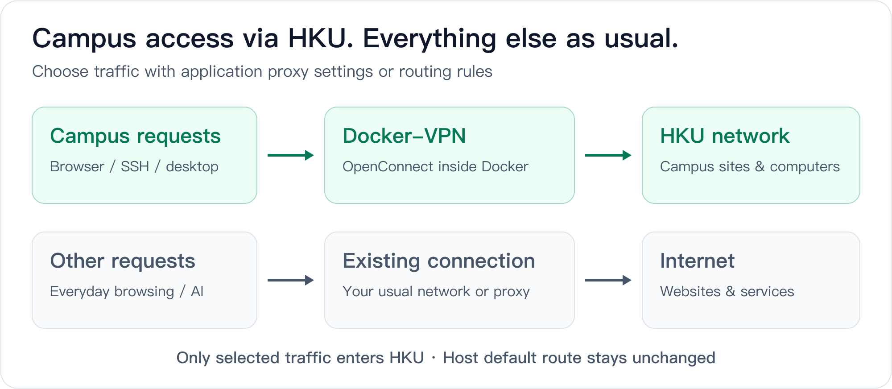
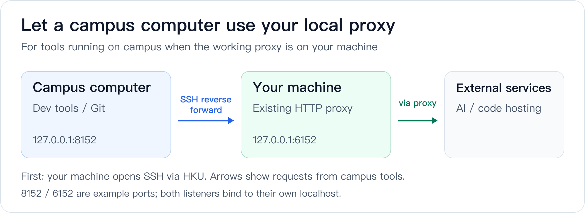

#  Docker-VPN (HKU Edition)

**Access HKU's campus network while keeping your usual Internet connection.**

[English](Readme.md) · [简体中文](README.zh-CN.md) · [Project website](https://rqhu1995.github.io/docker-vpn/) · [Full guide](docs/guide.en.md)

Need campus resources, lab SSH, or remote desktop while your browser and AI tools keep using their usual connection? Docker-VPN runs the HKU VPN inside Docker and exposes a local proxy. You choose which requests enter the campus network; your host's default route stays unchanged.

## What can you use it for?

| Your goal | How |
|---|---|
| Access HKU websites and campus resources | Set an application proxy or route by domain |
| SSH or remote desktop into a campus computer | Send that host's connections through HKU |
| Give campus development tools access to your local proxy | Share your existing proxy over reverse SSH (advanced) |



OpenConnect establishes the VPN inside the container, and local SOCKS5 / HTTP ports provide access to it. **Set a proxy directly in an application, or add Clash or Surge for automatic routing by domain or IP.**

## Quick Start

You need a working **Docker** runtime, `openssl`, a VPN-enabled HKU account, your **static Portal PIN**, and a **Microsoft Authenticator code**. The launcher uses `vpn2fa.hku.hk` with MFA; reachability depends on your network.

<details>
<summary>Need a Docker runtime?</summary>

On macOS, you can use Colima with Homebrew installed:

```bash
brew install colima docker
colima start --cpu 2 --memory 2 --disk 20 --vm-type vz --mount-type virtiofs
```

Docker Desktop also works. Use Docker Engine on Linux. On Windows, enable Docker Desktop's WSL2 integration and run the commands below inside WSL2.

</details>

### 1. Build the image

Check that `docker info` works, then run:

```bash
git clone https://github.com/rqhu1995/docker-vpn.git ~/docker-vpn
cd ~/docker-vpn
docker build -t local/vpn .
```

### 2. Set your account and PIN

```bash
mkdir -p ~/.vpn
cp ~/docker-vpn/examples/hku.env.example ~/.vpn/hku.env
nano ~/.vpn/hku.env
```

Set `HKU_USER` to your HKU account, for example `youruid@connect.hku.hk`. Then create the PIN file:

```bash
(umask 077; touch ~/.vpn/hku.pass)
chmod 600 ~/.vpn/hku.pass
nano ~/.vpn/hku.pass
```

Enter only your **static Portal PIN**, not the changing Authenticator code. In Nano, save with `Ctrl+O`, `Enter`, then exit with `Ctrl+X`. Your account and PIN stay outside the repository in `~/.vpn/`.

### 3. Connect and verify

```bash
~/docker-vpn/bin/hkuvpn
```

At `Response:`, enter the current six-digit Authenticator code. Keep the terminal open; `Ctrl+C` disconnects.

Test from a **second terminal**:

```bash
curl -x socks5h://127.0.0.1:1080 -I https://www.hku.hk/
```

HTTP response headers confirm that the proxy request works; access to individual campus resources still depends on your account permissions. If this fails, see [Troubleshooting](docs/guide.en.md#troubleshooting).

## Use the connection

| Integration | Address or configuration |
|---|---|
| SOCKS5 in an application | `127.0.0.1:1080` |
| HTTP proxy in an application | `127.0.0.1:1088` |
| Automatic routing with Clash Verge Rev / Mihomo | [Example](examples/clash-verge.yaml) · [Setup](docs/guide.en.md#clash-verge-rev--mihomo) |
| Automatic routing with Surge | [Example](examples/surge.conf) · [Setup](docs/guide.en.md#surge) |
| SSH / remote desktop | [Connect to a campus computer](docs/guide.en.md#ssh-and-remote-desktop) |

The proxies listen on localhost and forward TCP traffic; `socks5h` also resolves DNS through the proxy. With a rules client, **the VPN servers themselves must use a direct connection or an existing proxy**, to avoid routing back into Docker-VPN. The examples include these rules.

Everyday commands:

```bash
~/docker-vpn/bin/hkuvpn            # connect
~/docker-vpn/bin/hkuvpn --status   # check status
~/docker-vpn/bin/hkuvpn --stop     # stop
~/docker-vpn/bin/hkuvpn --recover  # repair Docker / Colima without MFA
```

[Install the short `hkuvpn` command](docs/guide.en.md#install-the-short-hkuvpn-command) · [Change the default ports](docs/guide.en.md#use-a-proxy-directly)

## Advanced: share your local proxy with a campus computer

Your development tools run on a campus computer, but the proxy they need is on your own machine. A reverse SSH tunnel lets those remote processes reach external services through your existing local proxy.



Keep the HKU VPN, SSH tunnel, and existing local proxy running. This step is unnecessary for AI websites used in your local browser. [Configuration and verification →](docs/guide.en.md#reverse-ssh-for-a-campus-computer)

---

More: [Troubleshooting](docs/guide.en.md#troubleshooting) · [Security](docs/guide.en.md#security) · [Compatibility and versions](docs/guide.en.md#compatibility-and-versions)

Adapted from [ethack/docker-vpn](https://github.com/ethack/docker-vpn). This repository has no `LICENSE` file; see [Credits and licensing](docs/guide.en.md#credits-and-licensing).
