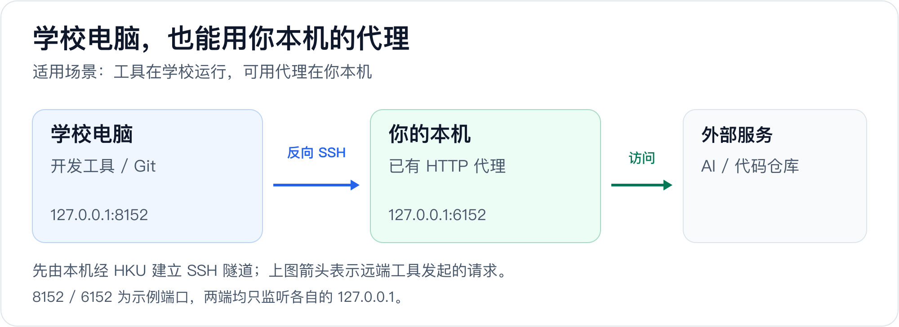

# hkuvpn 使用指南

[← 返回 README](../README.zh-CN.md) · [English](guide.en.md)

- [日常使用](#日常使用)
- [分流客户端](#接入规则客户端)
- [SSH 与远程桌面](#ssh-与远程桌面)
- [反向 SSH](#通过反向-ssh-为学校电脑提供代理)
- [常见故障](#常见故障)
- [安全与项目参考](#安全说明)

## 日常使用

### 安装简短的 `hkuvpn` 命令

[快速上手](../README.zh-CN.md#快速上手)直接调用 `~/hkuvpn/docker/bin/hkuvpn`。日常使用时，可以根据 Shell 安装更短的 `hkuvpn` 命令。

Zsh：

```bash
printf '\nsource ~/hkuvpn/examples/shells/hkuvpn.zsh\n' >> ~/.zshrc
source ~/.zshrc
```

Bash：

```bash
printf '\nsource ~/hkuvpn/examples/shells/hkuvpn.zsh\n' >> ~/.bashrc
source ~/.bashrc
```

Fish：

```fish
mkdir -p ~/.config/fish/functions
cp ~/hkuvpn/examples/shells/hkuvpn.fish ~/.config/fish/functions/hkuvpn.fish
fish -n ~/.config/fish/functions/hkuvpn.fish
```

不要把 Zsh 函数直接贴进 Fish。Fish 不使用 `export`、`VAR=value command`、POSIX `case` 和 POSIX 函数语法。

Windows 侧 PowerShell 的等价封装见 `examples/shells/hkuvpn.ps1`：把该文件路径加入 `$PROFILE` dot-source 即可，`hkuvpn`/`hku-status`/`hku-stop` 三个函数与 Shell 版语义一致。

> **从 v1.0.x 升级？** v1.1.0 起 Docker 版整体移进了 `docker/` 目录，Shell 封装移进了 `examples/shells/`。请更新你引用的路径：
>
> | 原来 | 现在 |
> |---|---|
> | `~/hkuvpn/bin/hkuvpn` | `~/hkuvpn/docker/bin/hkuvpn` |
> | `source ~/hkuvpn/examples/hkuvpn.zsh` | `source ~/hkuvpn/examples/shells/hkuvpn.zsh` |
> | `cp ~/hkuvpn/examples/hkuvpn.fish …` | `cp ~/hkuvpn/examples/shells/hkuvpn.fish …` |
> | `docker build -t local/vpn .` | `docker build -t local/vpn docker/` |
> | `~/hkuvpn/examples/hku.env.example` | `~/hkuvpn/docker/examples/hku.env.example` |
>
> 把上面的 `printf` 命令重跑一次即可修正 shell 配置里的路径 —— 残留的 `source`
> 行会让每个新终端都打印 `No such file or directory`。`~/.vpn/` 里的凭据保持不变，
> `HKUVPN_HOME` 仍然指向仓库根目录。

仓库不在 `~/hkuvpn` 时，设置 `HKUVPN_HOME`（旧的 `DOCKER_VPN_HOME` 仍然兼容）：

```bash
export HKUVPN_HOME=/path/to/hkuvpn        # Zsh/Bash
```

```fish
set -Ux HKUVPN_HOME /path/to/hkuvpn      # Fish
```

封装脚本会**按自身文件位置**定位仓库，所以只有把封装复制到别处时（Fish 版就是这种用法）才需要上面的路径。启动器本身同样按自身位置推导仓库根目录。

### 日常命令

```bash
hkuvpn              # 智能连接：预检→后台启动→提示输入 MFA→等隧道就绪→报告结果
hkuvpn              # 已连接时再运行 = 直接报告当前状态（幂等）
hkuvpn --check      # 只预检（Docker/配置/PIN/镜像/端口/时钟），退出码 0 即就绪
hkuvpn -f           # 经典前台模式：在 Response: 提示处输 MFA，Ctrl+C 断开
hkuvpn -d           # 后台连接但不提示，用 hkuvpn --mfa <code> 交付（脚本场景）
hkuvpn --mfa 123456 # 向后台容器发送六位验证码
hkuvpn --status     # 分层健康检查（docker/容器/隧道/代理/端到端）
hkuvpn --logs       # 持续查看容器日志
hkuvpn --stop
hkuvpn --recover    # 只修复 Docker 后端，不发起 MFA
```

默认（无参数）即智能模式：已连接则直接报告状态；否则静默预检、后台启动、等到 MFA 提示出现后再让你输入验证码（不浪费有效期），发送后自动等待隧道建立并做端到端确认，成功才返回。**验证码输错或过期会当场重新提示，无需重来**。无终端 stdin（脚本/管道调用）时自动退化为 `-d` 手动模式。

`--status` 逐层检查并返回可脚本化的退出码：`0` 全部正常，`1` Docker 不可用，`2` 容器未运行，`3` 隧道未建立，`4` 本地代理端口无监听，`5` 端到端探测失败。其中隧道层检查容器内默认路由是否经 `tun0`——只有路由已切换，后续代理流量才真正走 HKU 隧道。

所有地区都使用 `vpn2fa.hku.hk`。旧命令 `hkuvpn hk` 和配置项 `HKU_ENDPOINT=hk` 仍作为兼容写法保留，但连接的也是同一个官方服务。如果证书获取或 TLS 失败，请检查现有代理客户端为控制连接选择的路径；从中国大陆连接时，稍后重试或改用其他合规网络可能会有帮助。

### 直接使用本地代理

在第二个终端测试：

```bash
curl -x socks5h://127.0.0.1:1080 -I https://www.hku.hk/
curl -x http://127.0.0.1:1088 -I https://www.hku.hk/
```

需要通过代理解析 DNS 时使用 `socks5h`，不要使用 `socks5`。Docker 当前发布的是 TCP 端口，不应把该方案宣传为通用 UDP 代理。

单条命令使用 HKU 代理：

```bash
ALL_PROXY=socks5h://127.0.0.1:1080 curl https://lib.hku.hk/   # Zsh/Bash
```

Fish：

```fish
env ALL_PROXY=socks5h://127.0.0.1:1080 curl https://lib.hku.hk/
begin
    set -lx ALL_PROXY socks5h://127.0.0.1:1080
    curl https://lib.hku.hk/
end
```

默认端口冲突时，修改 `~/.vpn/hku.env`：

```ini
HKU_SOCKS_PORT=11080
HKU_HTTP_PORT=11088
```

### 接入规则客户端

hkuvpn 只提供本地 HKU 上游。规则客户端并非必需，也不限于某一个产品；Clash Verge Rev、Surge、sing-box、Quantumult X、Loon，以及其他支持本地 SOCKS5/HTTP 出站和有序规则的客户端都可以使用。请先启动 `hkuvpn` 并确认 `1080/1088` 已经监听，再启用这些配置。

所有客户端都必须保持相同的规则顺序：

1. HKU VPN 控制入口必须走本地 HKU 上游之外的路径，否则连接会在隧道尚未建立时进入自身隧道。
2. 只有明确的校园网段和 HKU 服务进入 HKU 策略。
3. 所有非 HKU 规则和最终规则继续遵循现有配置。

#### Clash Verge Rev / Mihomo

Clash Verge Rev 使用 Mihomo 内核，并支持 Merge 配置。为当前配置创建 Merge/扩展配置，加入 [examples/clients/clash-verge.yaml](../examples/clients/clash-verge.yaml) 的内容，并在每次修改后重新启用该配置。不要直接修改下载的订阅文件，否则订阅刷新时可能被覆盖。具体界面和语法可参考官方的 [Clash Verge Rev Merge 指南](https://clashvergerev.com/guide/merge)、[Mihomo SOCKS](https://wiki.metacubex.one/config/proxies/socks/) 和 [HTTP](https://wiki.metacubex.one/config/proxies/http/) 出站文档。

最小 Merge 配置如下：

```yaml
prepend-proxies:
  - name: HKU-SOCKS5
    type: socks5
    server: 127.0.0.1
    port: 1080
    udp: false
  - name: HKU-HTTP
    type: http
    server: 127.0.0.1
    port: 1088

prepend-proxy-groups:
  - name: HKU
    type: select
    proxies: [HKU-SOCKS5, HKU-HTTP, DIRECT]
  - name: HKU-CONTROL
    type: select
    proxies: [DIRECT]

prepend-rules:
  - DOMAIN,vpn2fa.hku.hk,HKU-CONTROL
  - DOMAIN,vpn2fa-a.hku.hk,HKU-CONTROL
  - DOMAIN,vpn2fa-b.hku.hk,HKU-CONTROL
  # - IP-CIDR,192.0.2.0/24,HKU,no-resolve
  - DOMAIN-SUFFIX,hku.hk,HKU
  - DOMAIN-SUFFIX,hku.edu.hk,HKU
```

必须使用 `prepend-rules`，因为放在现有 `MATCH` 规则之后的规则不会执行。注释中的 `192.0.2.0/24` 是 TEST-NET-1 文档地址；启用前应替换为实际需要的最小校园网段。如果官方 HKUVPN 服务器无法直连，请把能够到达该服务器的现有策略准确名称加入 `HKU-CONTROL`。

#### Surge

把 [examples/clients/surge.conf](../examples/clients/surge.conf) 合并到现有配置，不要覆盖整份配置。对应的最小片段如下：

```ini
[Proxy]
HKU-SOCKS5 = socks5, 127.0.0.1, 1080
HKU-HTTP = http, 127.0.0.1, 1088

[Proxy Group]
HKU = select, HKU-SOCKS5, HKU-HTTP, EXISTING-PROXY, DIRECT
HKU-CONTROL = select, DIRECT, EXISTING-PROXY

[Rule]
DOMAIN,vpn2fa.hku.hk,HKU-CONTROL
DOMAIN,vpn2fa-a.hku.hk,HKU-CONTROL
DOMAIN,vpn2fa-b.hku.hk,HKU-CONTROL
# IP-CIDR,<精确校园网段>,HKU,no-resolve
DOMAIN-SUFFIX,hku.hk,HKU
DOMAIN-SUFFIX,hku.edu.hk,HKU
```

请把 `EXISTING-PROXY` 替换为当前配置中的准确策略组名称。官方服务器能够直连时，`HKU-CONTROL` 选择 `DIRECT`；只有现有策略确实能够到达该服务器时才选择该策略。控制组绝不能选择 `HKU-SOCKS5` 或 `HKU-HTTP`。不要把注释中的校园网段替换成整个 `10.0.0.0/8`；家庭、公司和容器网络经常也使用这个 RFC 1918 地址段。

## 远程访问

### SSH 与远程桌面

校内主机只能通过 HKU 到达时，合并并修改 [examples/clients/ssh_config.example](../examples/clients/ssh_config.example)。下方 `192.0.2.10` 属于 RFC 5737 TEST-NET-1，只用于文档，不可能是真实校园主机；必须替换为自己所用电脑的精确 IP。

```sshconfig
Host campus-host
  HostName 192.0.2.10
  User yourname
  ProxyCommand nc -X 5 -x 127.0.0.1:1080 %h %p
  ServerAliveInterval 30
  ServerAliveCountMax 3
```

以后正常执行：

```bash
ssh campus-host
```

远程桌面建议在规则客户端的 TUN/增强模式中，按精确目标 IP 发到 HKU 组；也可以使用原生支持 SOCKS 的远程桌面客户端。进程规则通常依赖具体平台，而目标地址规则更稳定、更容易验证。

### 通过反向 SSH 为学校电脑提供代理

当 Coding Agent 运行在学校电脑，而付费节点只允许位于大陆的客户端接入时，可把大陆电脑上已经工作的规则客户端端口反向转发给学校电脑。

#### 流量方向



虽然选项叫 `RemoteForward`，SSH 控制连接仍由客户端主动建立。`-R` 在远端电脑创建监听端口，再把每个连接经 SSH 带回客户端可见的目标地址。

#### SSH 配置

```sshconfig
Host campus-host-tunnel
  HostName 192.0.2.10
  User yourname
  ProxyCommand nc -X 5 -x 127.0.0.1:1080 %h %p
  RemoteForward 127.0.0.1:8152 127.0.0.1:6152
  ExitOnForwardFailure yes
  ServerAliveInterval 30
  ServerAliveCountMax 3
```

显式写出远端 `127.0.0.1` 是安全要求。OpenSSH 默认也只绑定回环地址，但明确配置可以避免服务器日后修改 `GatewayPorts` 后意外成为校园网开放代理。

启动并验证：

```bash
ssh -N campus-host-tunnel
ssh campus-host 'curl -x http://127.0.0.1:8152 -I https://www.apple.com/'
```

远端电脑应尽量只给目标进程设置代理：

```bash
HTTP_PROXY=http://127.0.0.1:8152 \
HTTPS_PROXY=http://127.0.0.1:8152 \
NO_PROXY=localhost,127.0.0.1 \
codex
```

Fish：

```fish
begin
    set -lx HTTP_PROXY http://127.0.0.1:8152
    set -lx HTTPS_PROXY http://127.0.0.1:8152
    set -lx NO_PROXY localhost,127.0.0.1
    codex
end
```

如果只是使用 ChatGPT 或 Claude 网页，通常直接在本机浏览器打开即可，不需要反向隧道。当 Codex、Copilot、包管理器或 Git 进程实际运行在学校电脑上时，才需要该端口。

#### 保持隧道在线

```bash
brew install autossh
autossh -M 0 -N campus-host-tunnel
```

`-M 0` 表示使用 SSH 配置里的 ServerAlive 机制。macOS 可把命令放入用户 LaunchAgent。`autossh` 进程仍在运行不等于隧道一定健康，必须从远端用 `curl` 验证 `127.0.0.1:8152`。

如果 SSH 客户端和代理客户端也都在香港，而订阅只允许大陆入口，这个方案并不能解决问题，因为代理入口仍是监听 `6152` 的那台机器。此时应把代理客户端放到可达的大陆电脑/VPS，或购买支持的入口。

## 运行维护与故障排查

### 高级稳定性配置

#### OpenConnect 重连

容器入口现在启用详细时间戳和 30 分钟重连窗口。断连仍可能以 `CSTP Dead Peer Detection detected dead peer`、TLS read error、`Host is unreachable` 或 cookie 被拒绝结束。

启动器默认在每次连接前通过 DoH（`1.1.1.1`，备用 `8.8.8.8`，均按 IP 直连）现查 `vpn2fa`、`vpn2fa-a`、`vpn2fa-b` 的真实地址并为本次会话固定（`HKU_AUTO_RESOLVE=0` 关闭）。这同时解决了下面手动 `HKU_RESOLVE` 针对的问题：控制连接不再经过本地解析器，也就不受宿主规则客户端 fake-IP DNS 的影响。查到的地址每次都是现值，不存在过期问题。

如果首次跳转或重连后出现 TLS 失败、`401 Unauthorized` 或 cookie rejected，可能是 DNS 把会话切到了另一个 HKU 后端。高级用户可以在单次会话同时固定入口和两个官方跳转后端：

```ini
HKU_RESOLVE=vpn2fa.hku.hk:REAL_IP,vpn2fa-a.hku.hk:REAL_IP,vpn2fa-b.hku.hk:REAL_IP
```

只能使用真实 DNS 或代理客户端真实 DNS cache 得到的 IP；不要使用 Enhanced Mode 的 `198.18.0.0/15` fake IP。容器入口脚本会把逗号分隔的映射转换为多条 `--resolve`。HKU 基础设施变化后应重新核对每个地址，过期固定地址会直接造成断连。

#### Colima 恢复层级

1. 用 `docker info` 检查主机 Docker socket，不能只看 `colima status`。
2. 用 `hkuvpn --recover` 启动或重启 Colima，同时避免重复发起 MFA。
3. 用 `colima ssh -- docker info` 区分“虚拟机内 Docker 正常”和“主机 socket 转发损坏”。
4. VZ 或磁盘挂载问题查看 `~/.colima/_lima/colima/ha.stderr.log`。
5. 只有控制面卡死时才使用 `colima stop --force`；macOS 可能需要一到数分钟释放 VZ 磁盘，再启动才会成功。

`colima delete` 会删除本地镜像和容器，应当是最后手段，不是默认排查命令。

Linux/WSL 上没有 Colima 一层：`--recover` 会尝试 `sudo -n systemctl start docker`（或 `service docker start`），无免密 sudo 时会打印需要手动执行的命令。WSL 开启 systemd 且 docker.service 为 enabled 时，发行版启动即自动拉起 Docker，通常无需手动 recover。

#### 不依赖规则客户端

便携启动器不会默认执行某个规则客户端的自动重载或策略切换，因为用户也可能使用其他客户端，或者完全不使用规则客户端。自行自动化时应保持三条约束：

- HKU 隧道失效时，把 HKU 流量切到明确的 fallback，例如 `DIRECT` 或已有香港线路。
- `vpn2fa.hku.hk`、`vpn2fa-a.hku.hk` 和 `vpn2fa-b.hku.hk` 绝不能进入 `HKU-SOCKS5`。
- 只有 `1080/1088` 监听和 VPN 隧道都确认健康后，才恢复 HKU 组。

### Windows / WSL

> 原生方案：不想开 WSL 的话，[windows 原生移植](../windows/README.zh-CN.md) 用官方 OpenConnect Windows 版 + gost 直接在 Windows 上运行，无需 Docker/WSL。但它的路由模型不同：港大网关不下发任何分流路由，所以原生版改为**按需路由**，且只路由你交给它代理的流量（详见[授权资源自动路由](../windows/README.zh-CN.md#授权资源自动路由)）。

Docker 运行在 WSL 内（Docker Engine，推荐开启 systemd）时，除上面的通用内容外还需要注意：

- **fake-IP DNS 污染**：Windows 上的规则客户端（Surge Enhanced Mode、Clash fake-IP 等）会劫持 DNS，其结果经 WSL 的 resolv.conf 传导进容器——`vpn2fa.hku.hk` 可能被解析成 `198.18.x.x` 假地址，导致控制连接隐式依赖规则客户端的转发行为。启动器默认的 DoH 自动固定（见上文）就是为了绕开这一点；也请确认规则客户端对 `vpn2fa*` 三个域名使用 DIRECT/HKU-CONTROL，避免环路。
- **时钟漂移**：Windows 睡眠唤醒后 WSL 时钟可能偏差数分钟，导致 openconnect 报出难以理解的证书/TLS 错误。启动器会预检（偏差超过 120 秒时拒绝连接并提示）；修复方法是在 WSL 内执行 `sudo hwclock -s`，或等待系统自动重新对时。
- **Windows 侧封装**：`examples/shells/hkuvpn.ps1` 提供 PowerShell 函数（`hkuvpn`、`hku-status`、`hku-stop`），MFA 交互可透传；退出码语义见 `--status`。
- **SSH 到校园主机**：`examples/clients/ssh_config.wsl.example` 是 Windows 侧 `~/.ssh/config` 的标准写法——ProxyCommand 经 `wsl.exe` 在发行版内运行 ncat，再连 `127.0.0.1:1080`。该写法在任何 WSL 网络模式下都成立（不依赖回环互通），且 SOCKS5 远程解析让校园主机名在容器内、经 HKU 隧道解析，不受 Windows DNS 影响。
- **回环互通模式的安全边界**：新式 WSL 网络模式（mirrored 及更新的共享回环模式）下，`127.0.0.1:1080/1088` 对整个 Windows 用户会话可见——安全边界是"本 Windows 用户"，而不只是 WSL 内。单用户机器可以接受，但不要把它理解成"仅本 WSL 可见"。
- **`--recover`**：在 WSL/Linux 上会尝试用 `sudo -n systemctl start docker`（或 `service docker start`）拉起 Docker；无免密 sudo 时会给出明确提示。WSL 开启 systemd 且 docker.service 为 enabled 时，发行版启动即自动拉起 Docker，通常无需手动 recover。

### 常见故障

#### tmux/终端会话立即消失

先查 Docker。Colima 主机 socket 不可用时，启动器可能在出现 MFA 之前退出：

```bash
docker info
colima status
hkuvpn --recover
```

#### 无法获取证书

检查 `vpn2fa.hku.hk` 及其 `vpn2fa-a` / `vpn2fa-b` 跳转后端是否使用控制策略，而不是本地 HKU 代理。确认服务器和路由无误后，只删除证书 cache：

```bash
rm ~/.vpn/pin-hk.cache
```

前台连接时若因证书/TLS 错误失败，启动器会询问是否自动重取 pin 并重试一次（防止 HKU 轮换证书后留下过期的 pin cache）。

#### WSL 中证书/TLS 错误（时钟漂移）

Windows 睡眠唤醒后 WSL 时钟可能偏差数分钟，openconnect 会报证书类错误。启动器已预检（偏差超过 120 秒直接提示并停止），若手动排查：

```bash
curl -fsSI https://1.1.1.1 | grep -i ^date   # 对比本地时间
sudo hwclock -s                               # 修复
```

#### 端口被占用

`hkuvpn --check` 会直接探测端口占用并给出改端口的方法。手动排查：

```bash
lsof -nP -iTCP:1080 -sTCP:LISTEN
```

在 `~/.vpn/hku.env` 选择其他主机端口，并同步修改代理客户端配置。

#### 容器在线但服务不可用

逐层测试：

```bash
docker ps --filter name=vpn-hku
hkuvpn --status
curl -x socks5h://127.0.0.1:1080 -I https://www.hku.hk/
ssh -G campus-host | grep -E 'proxycommand|hostname|port'
```

仅看到 `autossh` 进程或 `colima status` 正常，不构成端到端成功证据。

如果 `--status` 显示 tunnel up 但 e2e 失败，并提示"session looks frozen"（150 秒无心跳）：说明 **DTLS/UDP 数据通道在这条网络路径上不通**，openconnect 的 MTU 探测可能把会话卡死（tun0 存在、路由在、TCP 控制通道还活着，但零数据流动）。WSL 里 Windows 规则客户端对 UDP 的处理随节点/策略变化，是常见诱因。处理：

```bash
hkuvpn --stop
# 在 ~/.vpn/hku.env 加 HKU_DTLS=0（或临时 HKU_DTLS=0 hkuvpn），强制走 TCP 通道后重连
```

SSH 等交互场景不受 TCP 通道的速度影响；需要大吞吐时再改回 DTLS 默认值。

### 安全说明

- 本地代理只绑定主机回环地址。没有认证和防火墙时不要发布到 `0.0.0.0`。注意：WSL 共享回环的网络模式下，回环端口对整个 Windows 用户会话可见（见上文 Windows / WSL 一节）。
- Remote Forward 也只绑定远端回环地址；本场景不要启用 `GatewayPorts yes`。
- `~/.vpn/hku.pass` 是明文，权限应为 `600`，电脑应启用全盘加密。启动器通过只读单文件挂载把它送进容器（`/run/hku-pass`），PIN 不会出现在 `docker run` 参数、宿主机进程列表或 `docker inspect` 的环境变量里。
- 有 Docker 权限的用户可查看容器配置，应把 Docker 权限视为高权限。
- 容器按最小权限运行：`--cap-drop ALL --cap-add NET_ADMIN`（tun 和路由操作）与 `DAC_READ_SEARCH`（读取只读 PIN 挂载所需）、`--security-opt no-new-privileges`、pids/memory 上限，并直通 `/dev/net/tun`。重建前应审查代码，不使用来历不明的镜像。
- 不要在 issue 或 commit 中提交真实校园主机、账号、证书 cache、日志、订阅 URL 和 SSH 私钥。

## 项目参考

### 工作原理

1. 先运行 `hkuvpn`。容器建立 OpenConnect 隧道，gost 以单进程开放仅本机可访问的 SOCKS5 和 HTTP 监听端口。
2. 监听端口就绪后，再把其中一个地址填入应用、SSH 配置、浏览器或可选的分流客户端。
3. 实际使用时，被配置选中的请求到达 `1080` 或 `1088`，进入容器，再通过 HKU AnyConnect 隧道传输。
4. 分流客户端可以同时把所有非 HKU 请求发到 `DIRECT`、现有代理或 VPN，以及其他任意策略。除非用户明确为这些请求选择 HKU 上游，否则它们不会经过 hkuvpn。

这里的 Cisco AnyConnect 指服务端协议。HKU 连接并不启动 Cisco 官方桌面客户端，而是由容器内的 OpenConnect 建立，因此不会修改主机的全局默认路由。

### 兼容性与版本

| 范围 | 当前支持情况 |
|---|---|
| macOS 容器环境 | Colima 或 Docker Desktop |
| Linux 容器环境 | Docker Engine |
| Windows | Docker Desktop + WSL2，或 WSL 内原生 Docker Engine；详见[Windows / WSL](#windows--wsl) |
| Shell | Zsh、Bash 和 Fish；Windows 侧提供 PowerShell 封装（`examples/shells/hkuvpn.ps1`） |
| 规则代理客户端 | 提供 Clash Verge Rev/Mihomo 和 Surge 示例；sing-box 等可采用同一分流模型 |
| 镜像内本地代理 | gost 3.3.0（静态 Go 单二进制，单进程提供 SOCKS5 与 HTTP 监听） |
| 当前 `alpine:3.23` 镜像内 OpenConnect | 9.21 |
| [Windows 原生版](../windows/README.zh-CN.md) 的 OpenConnect | 9.21（官方 GitLab CI 的 v9.21 tag 构建，SHA-256 固定；安装包自带 Wintun 驱动） |
| Windows 原生版的 gost | 3.3.0（windows/amd64，SHA-256 固定） |

OpenConnect 在镜像内运行，因此不会使用主机上通过 Homebrew 安装的 OpenConnect。由于 Alpine 3.23 软件包仍是旧版，Dockerfile 会从官方发布源码构建 OpenConnect 9.21。构建在编译前同时校验固定的 SHA-256 摘要，以及与 OpenConnect 官方发布密钥指纹匹配的 PGP 签名。编译配置只保留 HKU 用到的认证方式（表单密码 + 网页 MFA），不含 GSSAPI、SecurID（stoken）、OATH 与智能卡支持。排查版本相关问题或准备升级版本时，请查看 [OpenConnect 官方 Releases](https://gitlab.com/openconnect/openconnect/-/releases)。

需要确认本地镜像实际安装的版本时执行：

```bash
docker run --rm --entrypoint openconnect local/vpn --version
```

除 OpenConnect 外，镜像的每一层构建输入同样有固定校验：`alpine` 基础镜像按 digest 固定；`vpnc-script` 不再在构建时拉取上游 master，而是 vendor 进仓库并在构建期校验 SHA-256（来源：openconnect/vpnc-scripts commit `ce9e961b`）；本地代理 gost 以 GitHub Releases 官方 checksums 固定版本与哈希（v3.3.0）。整个构建没有任何"拉最新"的外部输入，可复现。

### 便携核心与可选自动化

hkuvpn 的便携核心包括启动器、Shell 包装函数、路由示例和容器入口，不依赖规则客户端、tmux 或某一个特定终端应用。

需要无人值守或长期运行时，可以按实际环境加入代理客户端 CLI 自动化、tmux 监控、macOS LaunchAgent 等系统服务，以及 `~/.vpn/logs/` 诊断日志。这些集成应保持可选和机器相关，确保基础 HKU 代理仍能配合其他代理客户端和 Docker 环境使用。

### 仓库结构

仓库包含两个互相独立的版本，以及两者共用的材料。

| 路径 | 内容 |
|---|---|
| `docker/` | Docker 版：`Dockerfile`、启动器 `bin/hkuvpn`、容器内路由脚本 `etc/vpnc-script`、MFA 入口 `hku-connect.exp`、`examples/hku.env.example`，以及构建期校验签名所用的 OpenConnect 发布公钥 |
| `windows/` | Windows 原生版：启动器 `bin/hkuvpn.ps1`、工具下载脚本 `bin/get-tools.ps1`、仅分流不改默认路由的 `etc/vpnc-script-win.js`、`examples/hku.env.example`，以及本版本说明 |
| `windows/mygo-app/` | 桌面 App（`HKUVPN.exe`）：MyGo 原生 UI，驱动同一个 worker —— 源码、托盘与面板图标、`build.sh` |
| `windows/tests/` | `session-flow.ps1`，会话生命周期的回归脚本 |
| `examples/clients/` | 规则客户端与 SSH 的接入示例（Clash Verge Rev / Mihomo、Surge、`ssh_config`） |
| `examples/shells/` | Zsh、Bash、Fish、PowerShell 的简短 `hkuvpn` 命令封装 |
| `docs/` | 本指南与配图 |

新增文件时的约定：

- 版本目录保持自洽：某个版本运行时需要的文件都放在 `docker/` 或
  `windows/` 下，两个版本之间不互相引用。
- 真正被两个版本共用的内容放在 `examples/` 或 `docs/`。
- Docker 构建上下文是 `docker/`，因此 `docker/.dockerignore` 决定哪些文件
  进入镜像；构建输入（`docker/etc`、`docker/keys`、`docker/hku-connect.exp`）
  不要写进忽略列表。
- `HKUVPN_HOME`（旧名 `DOCKER_VPN_HOME`）指向仓库根目录；未设置时
  `docker/bin/hkuvpn` 会根据自身位置推导根目录，不再假定是 `~/hkuvpn`。

### 来源与许可证

hkuvpn 以 [MIT 许可证](../LICENSE) 发布。上游署名与第三方声明汇总在
[NOTICE](../NOTICE)。

本项目基于 [ethack/docker-vpn](https://github.com/ethack/docker-vpn)，经由
[rqhu1995/docker-vpn](https://github.com/rqhu1995/docker-vpn) 的 HKU 版改造而来，
并针对 HKU、OpenConnect MFA、本机回环代理、授权资源自动路由，以及免 WSL/Docker
的 Windows 原生运行做了进一步适配。上述两个上游项目发布时均未附带明确许可证；
本仓库发布的内容适用上述 MIT 条款，并完整保留上游署名。

其中一个文件保留其自身许可证：`docker/etc/vpnc-script` 原样 vendored 自
[openconnect/vpnc-scripts](https://gitlab.com/openconnect/openconnect/-/tree/master/vpnc-scripts)，
仍按其文件头声明的 GNU General Public License v2 授权。港大 VPN 服务器由香港大学
运营，本项目为非官方客户端，与港大无隶属或背书关系。
